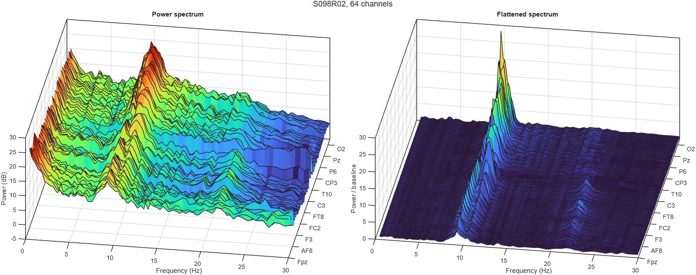
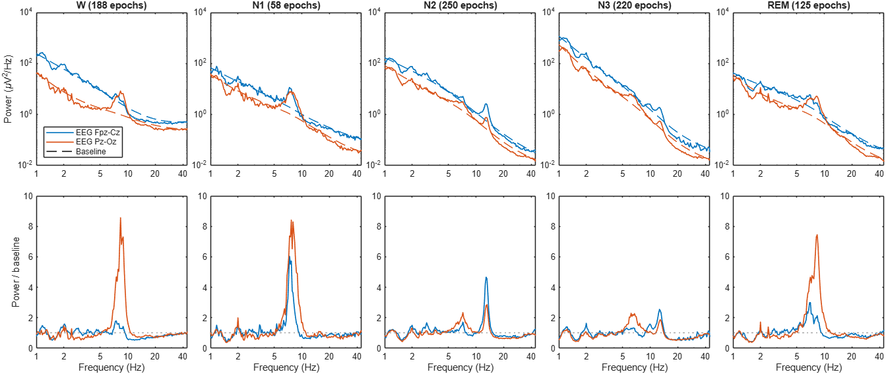

# FLAT: Flattening spectra using the Local Aperiodic Trend

[](https://doi.org/10.5281/zenodo.23548995)

**FLAT** separates an EEG or MEG power spectrum into its smooth aperiodic
background, the *baseline*, and the periodic activity on top of it. Dividing
power by the baseline gives a flattened spectrum in which oscillations stand
out as peaks above 1.



*One minute of 64-channel resting EEG with eyes closed, before (left) and after
flattening (right). Besides alpha, the flattened spectra show a beta peak
around 20 Hz that is hard to see in the power spectra. Channels run from
anterior (front) to posterior (back).*



*One night of sleep EEG. Top: power spectra per sleep stage with their
baselines (dashed). Bottom: flattened spectra, showing alpha in wake and sleep
spindles in N2 and N3.*

## Why FLAT

- **No settings.** There is no peak model, no model of the background and
  nothing to tune, so every recording is processed in the same way.
- **Any smooth background.** The baseline is a local trend over two octaves.
  It follows knees and bends without needing a model for them.
- **Robust to narrow peaks.** Medians taken after removing the local slope
  keep narrow peaks from lifting the baseline, even on a steep background,
  and a robust continuation keeps the full window at both ends of the range.
- **The full data.** The flattened spectrum shows every deviation from the
  background, including noise, without thresholds or peak detection.
- **Works on any spectrum.** Welch, multitaper or wavelet spectra can be used
  directly; neither the time series nor data beyond the analyzed range are
  needed.
- **Fast, working in MATLAB and Python.**

The baseline slope from 2 to 24 Hz summarizes the background. For a power law
$1/f^\chi$ it equals $-\chi$, so it corresponds to −1 times the aperiodic
exponent of specparam (FOOOF) in its fixed mode. The
[method description](docs/method.md) explains the algorithm, the choice of its
fixed constants, its properties and its limits.

## Getting started

Both implementations have the same interface:

```matlab
[flattened, baseline, slope] = flatten_spectrum(power, freqs);   % MATLAB
```

```python
flattened, baseline, slope = flatten_spectrum(power, freqs)      # Python
```

- [MATLAB: setup, usage and examples](README_matlab.md)
- [Python: installation, usage and examples](README_python.md)

The examples flatten your own recordings or download public data: one minute
of 64-channel resting EEG and one night of sleep EEG. Several more example
figures are in [examples/figures](examples/figures);
[examples/figures/MEG](examples/figures/MEG) holds waterfall plots of MEG
source spectra for all sleep stages as rotatable MATLAB figures.

## Example data

The examples use data from [PhysioNet](https://physionet.org) (Goldberger et
al., 2000, *Circulation* 101:e215–e220), licensed under the Open Data Commons
Attribution License 1.0:

- [EEG Motor Movement/Imagery Dataset](https://physionet.org/content/eegmmidb/1.0.0/):
  Schalk et al. (2004), *IEEE Trans Biomed Eng* 51:1034–1043.
- [Sleep-EDF Database Expanded](https://physionet.org/content/sleep-edfx/1.0.0/):
  Kemp et al. (2000), *IEEE Trans Biomed Eng* 47:1185–1194.

## License

[MIT](LICENSE), © 2026 Tobias C. Haase and Steffen Gais.
